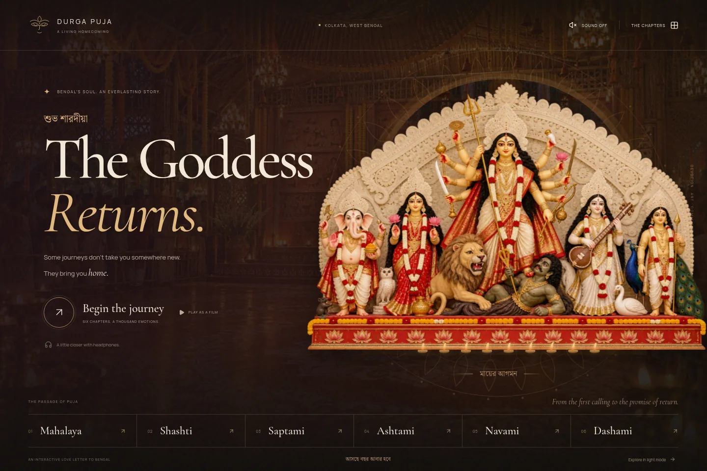

# The Goddess Returns

An interactive Durga Puja homecoming, built with Next.js, React Three Fiber and GSAP. Six chapters carry visitors from the first calling of Mahalaya to the river farewell of Dashami, preserving the original Bengali narrative and devotional artwork.



## Run

Node.js 20.9 or newer is required.

```sh
npm ci
npm run dev
```

Open http://localhost:3000. For the production export:

```sh
npm run build
npm run preview
```

Deploy the generated `out/` directory to any static host. This project does not use `next start`.

## The experience

- A lamp-lit opening with a full family tableau, original alpona-inspired ornament, pointer parallax and locally hosted English/Bengali fonts.
- Six scroll-directed scenes with layered artwork, WebGL incense, instanced petals, river shimmer and organic scene dissolves.
- Real brass bell and lamp geometry, with a responsive bell gesture and warm light.
- A chapter atlas, image previews, keyboard controls, a scrubbable timeline and optional film playback.
- A different interaction in every chapter: bell, light, water, flowers, percussion and river lamps.
- Detailed Story & Rituals panels retaining the original context and sources.
- Responsive phone compositions, explicit motion controls, system reduced-motion support, and complete light/no-JavaScript fallbacks.

Sound is off initially. Enable it in the header or use the bell/drum controls. The original synthesized ambience and percussion are artistic interpretations, not field recordings. Optional user-supplied recordings remain supported; see [audio setup](public/audio/README.md).

The sacred figures and people remain photographic-style artwork. This is a layered animated experience, not live-action video or a volumetric idol scan. Read the [art documentation](public/art/README.md) and [design research](RESEARCH.md).

## Controls

| Action | Control |
| --- | --- |
| Travel through the chapters | Scroll, swipe or drag the timeline |
| Jump to a chapter | Bottom navigation or The Chapters atlas |
| Previous / next chapter | Arrow buttons, or left/right keys outside controls |
| Play the journey | Play Journey; wheel or touch pauses playback |
| Read the cultural context | The Story & Rituals |
| Close a panel | Close button or Escape |
| Quiet the visuals | Motion button; device reduced-motion preference is always respected |
| Look without text | Eye button; Escape restores the story |
| Explore without WebGL | Explore in light mode on the opening |

## Verify

```sh
npm test
npm run build
npx playwright install chromium
npm run test:e2e
```

For an existing system Chromium installation:

```sh
PLAYWRIGHT_CHROMIUM_EXECUTABLE_PATH=/usr/bin/chromium npm run test:e2e
```

The suite covers the real exported app, including all six chapter interactions, sound, reading panels, focus containment, film playback, scrubbing, motion changes, WebGL failure/context loss, phone layouts and no-JavaScript content. Real mobile GPU performance and Safari have not been measured in this environment.

## Customize

- `src/components/chapters.js`: the original narrative, Bengali headings, rituals and sources.
- `src/components/journey.js`: visual titles, interaction copy, scene assets and shared timeline math.
- `src/components/Experience.jsx`: entry, navigation, playback and interaction state.
- `src/components/ExperienceDialogs.jsx`: chapter atlas and reading panels.
- `src/components/World.jsx`: layered artwork, petals, incense and river lamps.
- `src/components/SpatialStage.jsx`: brass geometry and animated lighting.
- `src/components/FestivalBackdrop.jsx`: image fitting, water and transition shaders.
- `src/components/useSound.js`: original synthesized score, bell and percussion.
- `src/app/globals.css`: the visual system and responsive layouts.

The design celebrates shared community and craftsmanship. It does not claim to document every regional tradition or reproduce a specific artist’s idol. Ritual timing and customs vary by community.
